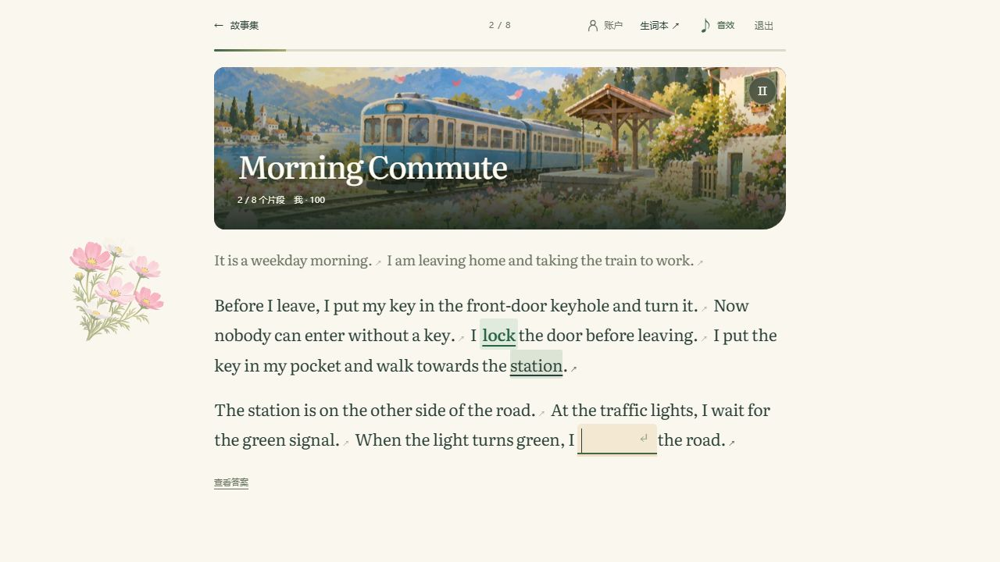

# Beck Xiong / topiniu

从前端出发，做业务全栈交付，探索 AI 在真实工作里的用法。也做一些自己想用的小产品，关于阅读、古诗词和英语练习。

**[个人网站 · topiniu.com](https://topiniu.com)** 是我主要更新的地方，放作品、开发记录和日常手记。这里保留代码与部分项目案例。

[关于我](https://topiniu.com/about/) · [个人作品](https://topiniu.com/projects/) · [文章](https://topiniu.com/posts/) · [X](https://x.com/beckxiong) · [邮件](mailto:beckxiong@gmail.com)

正在找下一份 **前端 / 全栈** 工作，城市不限。

## AI 与开发工具

### [Vision E2E / 猪猪 E2E](https://github.com/topiniu/vision-e2e-showcase)

个人独立开发的浏览器 E2E 工作台，覆盖 Electron / React 桌面面板、Playwright 执行器、HTTP/MCP 集成和证据报告链路。公开仓库是基于 v1.11 整理的脱敏求职展示版。

- 让桌面面板和 HTTP/MCP 入口共用执行引擎，支持可见页面与无头会话。
- 通过异步会话、进度事件、分层超时、取消和可选进程隔离处理长任务。
- 用显式断言判定结果，保存截图、trace、诊断和可校验的证据包。

演示使用本地合成网页，无需业务账号。按说明安装后运行 `npm run demo`，同时验证正例通过、故意错误的反例失败，并校验证据包。1.11.3 展示版通过 **748 项自动化测试**，验证记录和 CI 可查。

[开源仓库](https://github.com/topiniu/vision-e2e-showcase) · [可复现演示](https://github.com/topiniu/vision-e2e-showcase/blob/main/docs/demo.md) · [验证记录](https://github.com/topiniu/vision-e2e-showcase/blob/main/docs/verification.md) · [CI](https://github.com/topiniu/vision-e2e-showcase/actions/workflows/ci.yml)

[开发故事](https://topiniu.com/posts/zhuzhu-e2e/) · [早期 1.8.0 演示案例](cases/zhuzhu.md)

### [Office Lab](cases/office-lab.md)

我和 AI 一起搭建的研发工作台，用任务档案、角色交接与验收证据串联需求、开发、测试和人工确认。任务中断时，可以带着进度摘要切换到另一个 Agent 继续。

Office Lab 的案例使用虚构业务数据。

## 个人作品

### [Margin](https://margin.topiniu.com)　Kindle Coach

导入 Kindle 摘录，按书整理，随机翻看以前划过的句子。点开一张卡片，专心重读这一段。

`Next.js` · `TypeScript` · `Prisma` · `PostgreSQL`

公版摘录演示 · [打开 Margin ↗](https://margin.topiniu.com) · [项目说明](cases/margin.md)

### [孟趣](https://mengqu.topiniu.com)

每次读一首唐诗宋词。逐字动效、生字拼音，也可以生成二维码，把当前这首诗分享给朋友。

[打开孟趣 ↗](https://mengqu.topiniu.com) · [项目说明](cases/mengqu.md)

### [Word Duel](https://wd.topiniu.com/#word) / [Scene Duel](https://wd.topiniu.com/#scene)

Word Duel 是实时单词接龙，可以邀请朋友或与电脑对局。Scene Duel 是英语故事里的完形填空：根据上下文补全句子，遇到生词可以查看释义和作答解释。

[来一局单词接龙 ↗](https://wd.topiniu.com/#word) · [读一篇故事 ↗](https://wd.topiniu.com/#scene) · [项目说明](cases/scene-duel.md)

### [beauty-qrcode](https://github.com/topiniu/beauty-qrcode)

React 二维码组件，支持 DOM / SVG 渲染和从中心展开的动画。[看动效](https://github.com/topiniu/beauty-qrcode#readme)

---

更多作品与更新，见 **[topiniu.com](https://topiniu.com)**。
